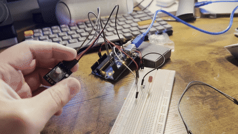
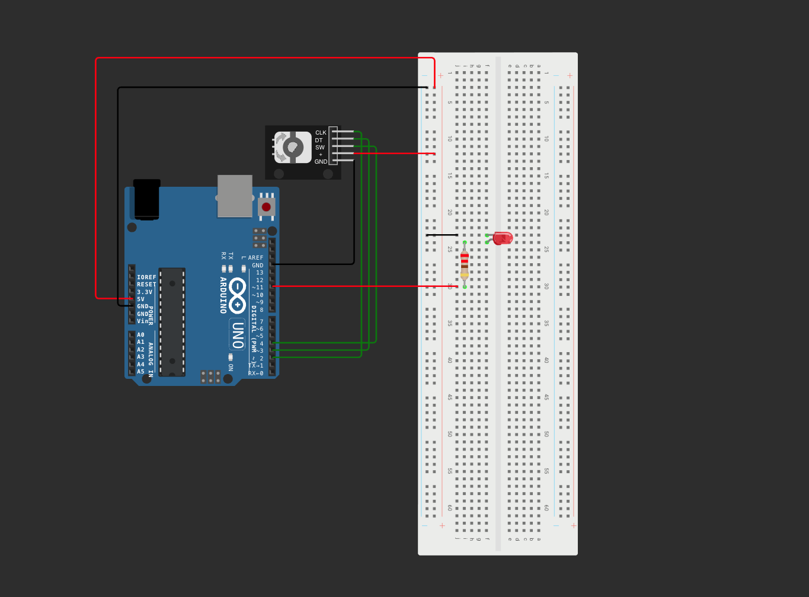

# Rotary Encoder LED Brightness Control

Turn a KY-040 rotary encoder to adjust an LED’s brightness with an Arduino Uno. This project uses digital encoder inputs and PWM output instead of a potentiometer.

## Demo

[Watch or download the original demo video](media/demo.mp4)

## Wiring diagram

## Components

- Arduino Uno and USB cable
- KY-040 rotary encoder module
- LED
- 220–330 Ω current-limiting resistor
- Breadboard and jumper wires

## Connections

| Component pin | Arduino connection |
| --- | --- |
| Encoder CLK | D2 |
| Encoder DT | D3 |
| Encoder SW | D4 (unused by this sketch) |
| Encoder + / VCC | 5V |
| Encoder GND | GND |
| LED anode (+), through resistor | D11 (PWM) |
| LED cathode (−) | GND |

Connect the breadboard ground rail to Arduino GND. The LED and resistor form a series path: **D11 → resistor → LED anode → LED cathode → GND**.

## Run the project

1. Download or clone this repository.
2. Open `Rotary_encoder_adjusting_light/Rotary_encoder_adjusting_light.ino` in the Arduino IDE.
3. Wire the components as shown above.
4. Select **Arduino Uno** and your board’s port, then upload the sketch.
5. Turn the encoder clockwise to increase brightness and counterclockwise to decrease it.

For Wokwi, create an Arduino Uno project, add the components above, reproduce the wiring, and paste the sketch into `sketch.ino`. No additional libraries are required.

## How the code works

- `INPUT_PULLUP` holds the encoder inputs HIGH until the encoder pulls them LOW.
- The loop detects when CLK changes from HIGH to LOW.
- DT determines the direction at that transition.
- Each detected step changes the stored brightness by **15**.
- `constrain()` keeps brightness between **0** (off) and **255** (maximum).
- `analogWrite()` sends PWM on D11 to control brightness. The initial value is **128**.

Change the `15` in both adjustment lines for smaller or larger steps. If your encoder turns in the opposite direction, swap CLK and DT or reverse the increment and decrement.

This is a simple polling sketch. Physical encoders can produce contact bounce; if brightness jumps on real hardware, debouncing or a rotary encoder library can improve reliability. The push button has no function in this version.

## Files

- `Rotary_encoder_adjusting_light/Rotary_encoder_adjusting_light.ino` — original commented Arduino sketch
- `media/wiring.png` — wiring screenshot
- `media/demo.mp4` — original hardware demonstration
- `media/demo.gif` — looping preview displayed in this README
